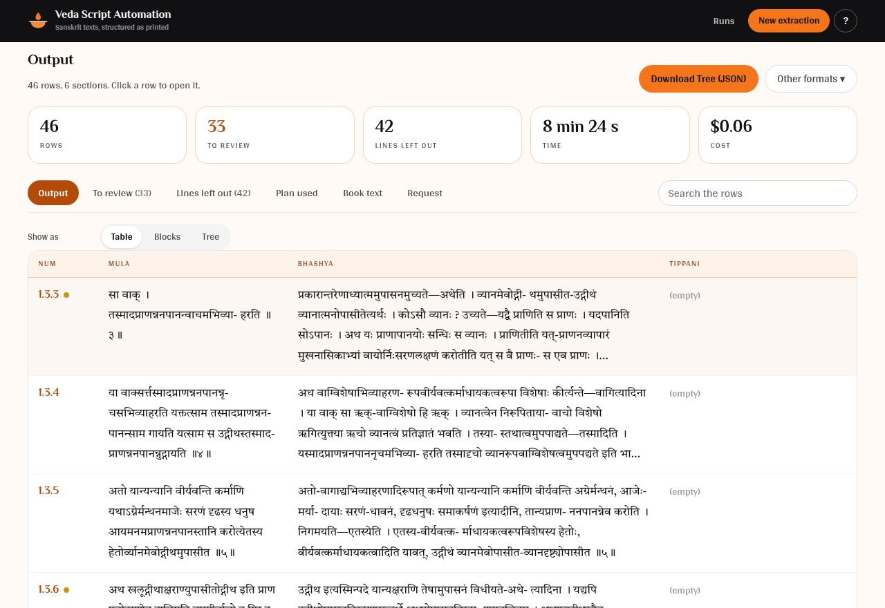

# Veda Script Automation

Turns the OCR text of a scanned Sanskrit book into one row per shloka (or mantra, or sutra), with its commentary, meaning and anything else printed with it.

You load the book text and say in plain words what you want. The AI works out the book's own structure (any number of section levels, and every kind of text printed with each unit) and shows you its plan, including the output file as it will look, before anything is extracted. You get a table, a list of text blocks, or a nested tree, as CSV or JSON.


**The AI never writes any of the output text.** Three AI agents decide what each line of the book *is* (root text, commentary, heading, page header). Code then copies the original text into the right row and column. Nothing is translated, summarised or "corrected" along the way.

Full documentation: **[docs/DOCUMENTATION.md](docs/DOCUMENTATION.md)**

## Contents

- [What it does](#what-it-does)
- [Run it on your computer](#run-it-on-your-computer)
- [Deploy it on Render](#deploy-it-on-render)
- [Use it from the command line](#use-it-from-the-command-line)
- [Settings](#settings)
- [Tests](#tests)
- [Project layout](#project-layout)
- [Current limits](#current-limits)

## What it does

1. **You load a book.** OCR text, with pages separated by lines of `---`.
2. **You write a request.** For example: "One row per mantra with the columns num, upanishad, bhashya. Put side headings at the start of the bhashya. Remove page headers and footnotes."
3. **The Analyst agent reads the book and shows you a plan**: the structure it found (for example adhyaya → khanda → mantra, with the printed lines that show each section), each kind of text and where it goes, the output file as it will look, and its questions for you. You approve it, correct it in your own words, change the columns and shape yourself, or stop.
4. **Labeler agents mark every line**, a few pages at a time. They check their own work and cannot finish while a check fails.
5. **Code builds the output** and numbers it (`1.2.5`), by counting the book's section lines, or by the location printed on each page when the OCR order cannot be trusted. Then it checks the whole book.
6. **The Reviewer agent takes a second look** at anything doubtful. What is still in doubt is listed for you.



You get:

- the output as a table, as blocks (one row per piece of text) and as a tree, to read in the page or download
- a **To review** list: the few places a person should check
- a **Lines left out** list: every line removed from the output, such as page headers and footnotes. Everything else is the book text exactly as printed, character for character, and code proves this on every run.

The agents run on Claude through the Anthropic API; the default model is Claude Opus 5.5. Before the switch to Claude, runs used GPT-6 Luna through OpenRouter: on the sample book (28 pages, 89 mantras) a run took 3–4 minutes, and on 24 pages of the Chandogya Upanishad, whose OCR prints the root text out of order, about 5 minutes. Time and cost on Claude have not been measured yet.

## Run it on your computer

You need [uv](https://docs.astral.sh/uv/) and one of these:

- **Your Claude Pro or Max plan.** Runs go through Claude Code on your computer and count towards the plan's usage limits. Anthropic does not allow a plan to serve other people, so a deployed copy uses it only if you alone use that copy (see `ALLOW_CLAUDE_PLAN` below).
- **An [Anthropic API key](https://platform.claude.com/settings/keys)**, billed for each run.

```bash
git clone https://github.com/me-shivamo/veda-script-automation.git
cd veda-script-automation
uv sync
uv run python -m web
```

Open **http://localhost:8000** and click **Claude connection** at the top. For your plan, run `claude setup-token` in a terminal, sign in, and paste the token it prints; if you already use Claude Code on this computer, its login works as it is. Or paste an API key. Both are saved in `.env` on your computer. Click **Use the sample book** to try it straight away.

## Deploy it on Render

The repository includes everything Render needs: [render.yaml](render.yaml) and a [Dockerfile](Dockerfile).

1. Push this repository to GitHub.
2. Open the link below, or in the [Render dashboard](https://dashboard.render.com) choose **New → Blueprint** and pick the repository.

   [](https://render.com/deploy?repo=https://github.com/me-shivamo/veda-script-automation)

3. Render asks for **`ANTHROPIC_API_KEY`**. Paste your key and start the deploy.
4. Wait for the first build to finish. It takes a few minutes.
5. On the service's **Environment** page, reveal **`APP_PASSWORD`**. Render created it for you.
6. Open the service's address. The browser asks for a username and password. The username is `veda`; the password is the one from step 5.

Three things to know before you rely on it:

- **The free plan forgets its runs unless you connect a database.** Its files are wiped whenever the service restarts, redeploys, or sleeps after 15 minutes without visitors. Set `DATABASE_URL` to a free [Neon](https://neon.com) Postgres database and every run is kept. See [Keeping runs permanently](docs/DOCUMENTATION.md#keeping-runs-permanently).
- **The first visit after a sleep takes about a minute** while Render wakes the service.
- **Everyone shares one password.** Anyone who has it can start runs, and runs spend your Anthropic credit.

Step-by-step instructions, the paid setup and troubleshooting: **[Deploying on Render](docs/DOCUMENTATION.md#7-deploying-on-render)**.

## Use it from the command line

```bash
uv run python -m agent run examples/mandala-brahmana/input.md \
  --request examples/mandala-brahmana/request.txt \
  --examples examples/mandala-brahmana/example_rows.csv
```

It shows the plan and waits for `y`, `n`, or the change you want. Results go to a new folder under `jobs/`.

| Option | What it does |
|---|---|
| `--request` | What you want, as text or a path to a text file (required) |
| `--examples` | CSV with a few rows of the output you want (optional, helps a lot) |
| `--model` | Claude model for all three agents (default `claude-opus-5-5`). Put `subscription/` in front, for example `subscription/claude-opus-5-5`, to run on your Claude plan. |
| `--analyst-model`, `--labeler-model`, `--reviewer-model` | A different model for one agent |
| `--escalation-model` | A stronger model for parts the Labeler cannot finish |
| `--spec path/to/spec.json` | Reuse a saved plan and skip the Analyst (for more books in the same series) |
| `--pages 1-10` | Only process these pages |
| `--auto-approve` | Do not stop to ask for approval |

## Settings

All settings are environment variables. On your computer, put them in `.env`. On Render, set them on the service's **Environment** page.

| Variable | Needed | What it does |
|---|---|---|
| `ANTHROPIC_API_KEY` | Unless you use your Claude plan | Pays for the AI models. On your computer, you can save it on the page instead. |
| `CLAUDE_CODE_OAUTH_TOKEN` | No | A token from `claude setup-token`, so runs use your Claude plan. On your computer, Claude Code's own login works too. |
| `ALLOW_CLAUDE_PLAN` | No | Set to `1` on a deployed copy that you alone use, so it may run on your Claude plan. Needs `APP_PASSWORD`. |
| `APP_PASSWORD` | On any public copy | When set, the browser asks for a username and password before showing anything. |
| `APP_USERNAME` | No | The username that goes with it. Default `veda`. |
| `JOBS_DIR` | No | Folder where runs are kept. Default `./jobs`. On a host, point it at a persistent disk. |
| `DATABASE_URL` | No | Postgres connection string. Keeps a copy of every run, so runs survive a host that wipes its files. |
| `MAX_ACTIVE_RUNS` | No | How many runs may be in progress at once. Default `3`. |
| `HOST`, `PORT` | No | Where the server listens. Defaults `127.0.0.1` and `8000`. Render sets these itself. |

## Tests

```bash
uv run pytest
```

29 tests cover the text handling, the agents' tools and the web interface. They use a scripted stand-in for the AI model, so they need no API key and cost nothing.

To score real runs against a book's expected output:

```bash
uv run python -m eval.bakeoff --book examples/mandala-brahmana --models claude-opus-5-5 --repeat 3
```

## Project layout

```
agent/
  prompts/         The agents' instructions, as plain markdown files
  core/            Text handling with no AI: pieces, labels, the Spec, assembling rows, checks
  plan.py          The plan shown before the full run
  export.py        Table, blocks and tree files
  agents/          The three agents and their tools
  orchestrator.py  Runs a book from OCR text to output files
  __main__.py      The command line
web/
  app.py           The web server
  static/          The page: index.html, app.css, one script per screen, the image
eval/              Scoring a run against expected output; comparing models
examples/          A sample book with its request and expected output
tests/             Tests (no API calls)
docs/              Documentation and screenshots
Dockerfile, render.yaml    Deployment on Render
```

## Current limits

- **Tested on two books, before the switch to Claude.** The figures above are for the sample book with GPT-6 Luna and GPT-5.6 Luna, and 24 pages of the Chandogya Upanishad with GPT-6 Luna. The Claude models have not yet been scored on them. Books with four or five levels of sections are handled by the code and its tests, but no real one has been run yet.
- **Text scrambled inside one unit is not reordered.** If the OCR reads the second half of a mantra before the first, the output keeps the OCR order and lists it for review.
- **Units must be numbered in the book**, with the number after each shloka, mantra or sutra (`॥ ५ ॥`). Unnumbered prose is not supported yet.
- **Fixes are not made in the page yet.** The review list tells you what to check; you correct the downloaded file yourself.
- **Footnotes** can be kept or dropped as a whole, but are not linked to the word they annotate.
- **Duplicated pages** in the OCR are reported, not removed.
- **The book text is sent to Anthropic**, which runs the Claude models. Do not load texts you are not allowed to share.
