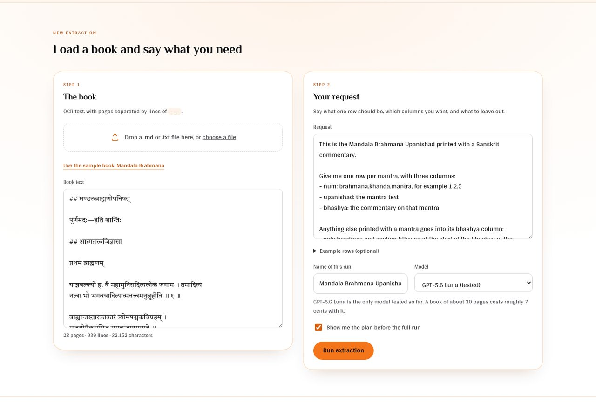
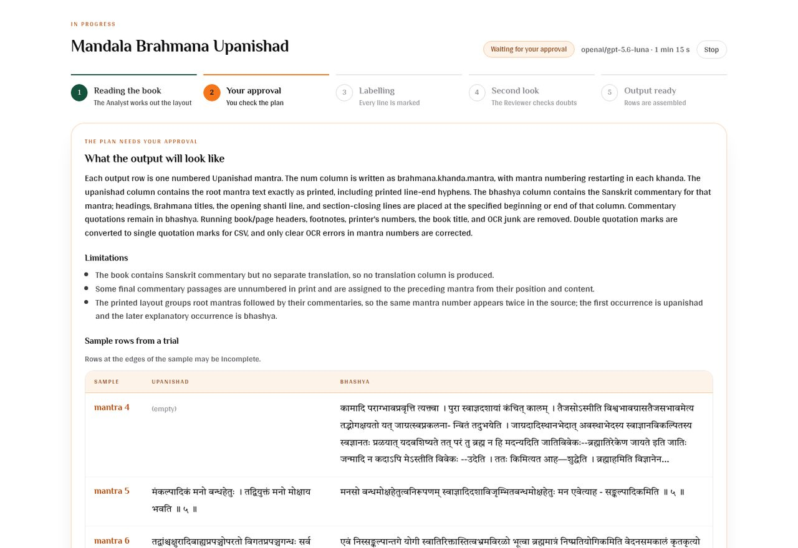

# Veda Script Automation: documentation

This guide covers how the tool works, how to use it, how to deploy it on Render, and how the code is organised.

## Contents

1. [What this is](#1-what-this-is)
2. [How it works](#2-how-it-works)
3. [Getting started on your computer](#3-getting-started-on-your-computer)
4. [Using the web page](#4-using-the-web-page)
5. [Preparing the book and writing the request](#5-preparing-the-book-and-writing-the-request)
6. [Checking the output](#6-checking-the-output)
7. [Deploying on Render](#7-deploying-on-render)
8. [Settings](#8-settings)
9. [The command line](#9-the-command-line)
10. [Costs](#10-costs)
11. [Security and privacy](#11-security-and-privacy)
12. [Troubleshooting](#12-troubleshooting)
13. [For developers](#13-for-developers)
14. [Limits and what is not built yet](#14-limits-and-what-is-not-built-yet)

---

## 1. What this is

Printed Sanskrit books are scanned and run through OCR. The OCR text has everything mixed together: the root text, the commentary, side headings, page headers, footnotes and stray marks.

This tool turns that text into structured output with **one entry per shloka** (or mantra, or sutra). Each entry holds the root text and whatever is printed with it: commentary, meaning, notes on the commentary, headings.

No two books are laid out alike, so nothing about the structure is fixed. The AI works out each book's own structure: how many levels of sections it has (अध्याय → खण्ड → मन्त्र, or four or five levels), whether some sections skip a level, which kinds of text belong to each unit and which text comments on which. You see what it understood before anything is extracted.

You tell it in plain words what you want. For example:

> One row per mantra, with the columns num, upanishad and bhashya. Put side headings at the start of the bhashya. Remove page headers and footnotes.

The output comes in three shapes, and every run writes all three:

| Shape | What it looks like | Good for |
|---|---|---|
| Table | One row per unit, one column per kind of text. The ID is `1.3.5`, or one column per level. | A spreadsheet. |
| Blocks | One row per piece of text: its place in the book, its layer (mantra, bhashya, …) and the text. | Books with many layers of text. |
| Tree | Nested JSON in the book's own shape: adhyayas holding khandas holding mantras. | Programs, and books with deep or uneven structure. |

You say which shape you want, or let the AI choose from your request. A short list of places a person should check comes with every run.

### The one rule it never breaks

**The AI never writes any of the output text.** It only decides what each line of the book is. Code then copies the original text into the right place. So the output cannot contain invented text, a translation the book does not print, or a "corrected" spelling.

Code does not change a single character either. Quotes, hyphens, stray marks and even a verse number the OCR misread stay exactly as in the text you loaded. The only thing left out of a line is the `##` mark the OCR tool puts in front of headings, which is not printed in the book. Lines removed as page headers or footnotes are all listed for you.

At the end of every run, a separate code check proves this: every output cell must be its lines' text joined by spaces, and every line of the input must be either in the output or on the list of removed lines. A run that fails this check cannot end as **Done**.

---

## 2. How it works

```
OCR text ──► pieces ──► Analyst ──► you approve ──► Labelers ──► code builds rows ──► Reviewer ──► output
            (code)      (AI)        the plan        (AI)         and checks them      (AI)
```

### Step by step

1. **Code cuts the book into small numbered pieces.** One piece is one printed line. A line is cut again after every verse number, so two shlokas on one line become two pieces.

2. **The Analyst reads the book and writes a plan.** It works out the structure first (the levels of sections, the unit, every kind of text and which text comments on which, and whether the OCR reading order can be trusted), then the columns. It tries the plan on a few pages. You are shown:
   - **what it found**: the levels, an outline of the sections with the lines that show each one, and each kind of text with a real example and where it goes;
   - **your output file**: the shape and columns, with the trial pages written out by the same code that writes the final file;
   - **its questions**: decisions it could not make alone, for you to answer.

   Nothing else happens until you approve. You can correct the plan in your own words, answer the questions, or change the columns and shape yourself (see [Step 3](#step-3-the-plan)).

3. **Labelers mark every piece.** The book is split into parts of about six pages, and several parts are worked on at once. A Labeler gives each piece a label, such as "root text of mantra 5", "commentary on mantra 5", "side heading" or "page header". It then runs the checks on its own work, and it is not allowed to finish while a check fails.

4. **Code builds the rows.** It copies the text of the pieces into rows. Where each row sits in the book is decided in one of two ways, chosen by the Analyst:
   - **Counted** (the usual way): code counts the lines that open and close sections (`इति प्रथमः खण्डः`) in reading order, so one wrong label cannot shift the numbering of the rest of the book.
   - **Printed**: some editions print the location on every page (`अ. १ खं. ४ मं. १-३`), and some OCR scrambles the order of a page (a boxed mantra read after its own commentary). There the Labelers give each passage the location printed on its page, and code places it there, whatever order the OCR gave.

   In both ways, the running headers that print a location are used to check every row's place, and an extract that starts in the middle of a book (say at खण्ड ३) is numbered from where it starts.

5. **Code checks the whole book.** See [the checks](#the-checks) below.

6. **The Reviewer takes a second look.** It sees the whole book, where a Labeler saw only a few pages. It goes through everything the checks found and everything a Labeler was unsure about. It fixes the labels it can. What it cannot settle stays on your review list.

### The three agents

| Agent | Runs | Its job | Its instructions |
|---|---|---|---|
| Analyst | Once per book | Understand the layout and write the plan | [agent/prompts/analyst.md](../agent/prompts/analyst.md) |
| Labeler | Once per part of the book | Label every piece in that part | [agent/prompts/labeler.md](../agent/prompts/labeler.md) |
| Reviewer | Once per book, after the rows are built | Fix or flag whatever is still doubtful | [agent/prompts/reviewer.md](../agent/prompts/reviewer.md) |

All three also read two shared files: [domain.md](../agent/prompts/domain.md), which describes how printed Sanskrit books are laid out, and [rules.md](../agent/prompts/rules.md), which holds the rules that always apply. These are plain text files. You can read and edit them.

### The checks

After labelling, code checks that:

- every piece has exactly one label, so nothing is silently lost
- verse numbers run in order inside each section, with no gaps
- each passage ends at its own verse number, and no text after a number is given that same number
- every row has the columns the plan says it must have
- nothing that looks like book text was thrown away as a page header or footnote (an agent cannot excuse this with a flag; the text must be kept)
- nothing that looks like a page header or footnote was kept as book text
- a line labelled as a heading does not read like a sentence or verse
- the output keeps reading order: nothing printed after a heading or after a section's closing line is moved back into the unit before it
- every row's place agrees with the location printed in the page headers, where the book prints one (this catches a misread closing line, such as `…षष्ठोऽध्यायः` printed where a khanda ends)
- a column does not end in a broken word (`…तत्प्रवि-`), which would mean its last words were put somewhere else
- in a book read in order, a unit's commentary does not come before its own root text

A Labeler has to fix a failed check, or flag the pieces with a reason. Flagged pieces go to the Reviewer, and then to you if they are still in doubt.

---

## 3. Getting started on your computer

### What you need

- **uv**, which installs Python and the packages. Install it from [docs.astral.sh/uv](https://docs.astral.sh/uv/).
- **A way to reach Claude**, one of:
  - **Your Claude Pro or Max plan.** Runs go through Claude Code on your computer and count towards the plan's usage limits, so you pay nothing extra. This works only on a copy running on your own computer: Anthropic does not allow a claude.ai login to power a service for other people.
  - **An Anthropic API key**, billed for each run. Create one at [platform.claude.com/settings/keys](https://platform.claude.com/settings/keys) and add some credit under Billing.

### Set it up

```bash
git clone https://github.com/me-shivamo/veda-script-automation.git
cd veda-script-automation
uv sync
```

### Start it

```bash
uv run python -m web
```

Open **http://localhost:8000** in your browser. To stop the server, press `Ctrl+C` in the terminal.

### Connect Claude

Click **Claude connection** at the top of the page. You do this once; the page remembers it.

- **Your Claude plan.** Open a terminal and run `claude setup-token`. Sign in to claude.ai in the browser window it opens, copy the token it prints (it starts with `sk-ant-oat`), paste it on the page and click **Save**. The page then asks Claude for a one-word reply to check that it works. If you already use Claude Code on this computer, you can skip the token: its login is used.
- **An API key.** Paste it in the second box and click **Save**.

Both are saved in the `.env` file, which stays on your computer and is never uploaded to GitHub. When a token or key is saved, the model list on the request form shows which models run on your plan and which on the API key. The plan's models come first.

To try it without your own book, click **Use the sample book** on the page.

---

## 4. Using the web page

The page has three places, linked from the dark bar at the top:

| Place | What it is |
|---|---|
| **Runs** | Every run, newest first, with its state, rows and cost. Click one to open it. |
| **New extraction** | Two steps: the book, then your request. |
| A run's page | Follows one run from start to finish: the plan, the progress, and the output. |

The **?** button explains how it works. Every run has its own address (`…/#/runs/<id>`), so you can bookmark it, share it with someone who can reach the same server, or reload the page without losing your place. `…/#/runs/<id>/review` opens it on the review list.

### Step 1: the book



Drop a `.md` or `.txt` file onto the box, click **choose a file**, or paste the text. The line under the box shows how many pages, lines and characters were loaded. Click **Next: your request**.

### Step 2: your request

Write what you want in the **Request** box, in Hindi or English. [Section 5](#5-preparing-the-book-and-writing-the-request) explains how to write a good one.

The other fields:

- **Example rows (optional).** A few rows of the output you want, as CSV. This is the most useful thing you can give the agents.
- **The output file (optional).** The shape (table, blocks or tree), the row ID (`1.3.5` or a column per level), where section titles and closing lines go, and the columns in order. Leave any of these to the AI; you can also change them on the plan.
- **Name of this run.** How the run appears in the list, and the name of the downloaded files.
- **Model.** Claude Opus 5.5 is the default and the most capable. Claude Sonnet 5.5 costs half as much, and Claude Haiku 5.5 a small fraction. None of them has been scored on the test books yet.
- **Show me the plan before the full run.** Leave this ticked unless you have already run the same kind of book and trust the result.

**Back** returns to the book without losing anything. Click **Read the book and show me the plan**.

### Step 3: the plan

The run's page shows its stages along the top: book and request, the plan, labelling, second look, output. While the Analyst reads the book (one to three minutes) the page says what it is doing.

When the plan is ready:



| Part | What it shows |
|---|---|
| **What I found in this book** | In plain words, what each row will hold. The structure as a chain (adhyaya → khanda → mantra) and the kinds of text each unit holds, with notes on which text comments on which. How rows are placed and numbered. An outline of the sections, each with the printed lines that show it. |
| **Each kind of text, and where it goes** | Every kind of line the book has, a real example from the book, and the column it goes to, or that it is left out. |
| **Your output file** | The shape, the row ID and the columns, and a preview: the trial pages written exactly as the file will be. |
| **Questions for you** | What the Analyst could not decide alone. **Yes** and **No** fill in the answer; you can also write one. |
| **Limitations** | What the book cannot provide, and oddities to know about. |

Then, in the bar at the bottom:

- **Approve and run** starts the full run.
- **Change the output file yourself.** Switch the shape or row ID, and use the buttons on each column to move it (‹ ›), rename it (✎) or put its text into another column (⤵). **Apply** makes these changes straight away, by code, without the AI.
- **Send to the Analyst.** Write a correction ("footnotes on the bhashya go in their own column") and/or answer its questions. The Analyst changes the plan, tries it again, and shows it once more. The page shows what you asked while it works.

Each new version of the plan starts with **What changed in version N**, so you can see your correction was taken up. **Stop** cancels the run.

### Step 4: the output


The boxes at the top show the number of rows, how many items need review, how many lines were left out, the time taken and the cost.

| Tab | What it shows |
|---|---|
| Output | The output, shown as a table, as blocks or as a tree (switch with **Show as**). Click a row to open it fully. Use the search box to find text. A gold dot marks a row with something to review. Section titles and closing lines kept apart from the units show as grey rows. |
| To review | The places a person should check. Click a row number to jump to that row. |
| Lines left out | Every line removed from the output (page headers, footnotes, printer's marks), with its page. |
| Plan used | The plan that was approved. |
| Book text, Request | What you gave. |

The orange button downloads the shape you chose. **Other formats** has the other shapes and a JSON file that names the book lines behind every cell.

## 5. Preparing the book and writing the request

### The book text

- **Pages are separated by a line containing only `---`.** Page breaks matter: they are how page headers and footnotes are recognised.
- **Each shloka, mantra or sutra must end with its number**, as printed: `॥ ५ ॥`. The tool relies on these numbers.
- Leave OCR marks such as `##` and `[^1]:` as they are. The agents know what they mean.
- Do not correct spellings or tidy the text first. The agents work with the text as it is, and the output keeps it exactly.

### The request

A good request answers four questions.

1. **What is one row?** "One row per mantra."
2. **Which columns, with which names?** "Columns: num, upanishad, bhashya."
3. **Where does the extra text go?** "Side headings go at the start of the bhashya of the mantra that follows. Closing lines such as इति प्रथमः खण्डः go at the end of the bhashya before them."
4. **What should be removed?** "Remove the book title, page headers, footnotes and printer's numbers."

The text itself is always copied exactly as printed, so there is nothing to say about quotes, hyphens or spelling.

The request for the sample book is in [examples/mandala-brahmana/request.txt](../examples/mandala-brahmana/request.txt). Use it as a pattern.

### What you cannot ask for

The tool only copies what the book prints. If you ask for a translation and the book has none, that column stays empty and the plan tells you so.

### Example rows

If you already have a few rows of the output you want, paste them into **Example rows**. Use the same column names as in your request. Three to five rows are enough. The Analyst compares them with the book to work out details you did not think to mention.

---

## 6. Checking the output

No run should be trusted blindly. The tool tells you where to look.

### The "To review" list

| Label | What it means | What to do |
|---|---|---|
| Printed number differs | The OCR text has a verse number that breaks the sequence, such as ९ where ५ belongs. The row is placed as ५, but its text keeps the ९ exactly as in the OCR. | Check the printed page and correct the downloaded file if needed. |
| Flagged by an agent | An agent was unsure about a line and explains why. | Read the reason and check that row. |
| Missing part | A row lacks a column it should have, for example a mantra with no commentary. | Check whether the book really has none. |
| Possibly dropped text | A line was removed as a page header or footnote but looks like book text. | Check that nothing real was lost. This is always an error. |
| Not an exact copy | The output differs from the book text. This should never happen; it means a fault in the code. | Do not use the output. Report the run. |
| Possible page header in text | A line kept in a row looks like a page header or footnote. | Check that row, usually where a passage crosses a page. |
| Possible heading mistake | A line was treated as a heading but reads like a sentence. | Check the start of that row. |
| Numbering doubt, Number missing, Numbers out of order | The verse numbers do not run in order here. | Check for a verse missing from the OCR. |
| Duplicated page | The OCR contains the same page twice. | Remove one copy from the book text and run again. |
| Section does not start at 1, Text at the start, Text at the end, Line not labelled | Something unusual at the edge of a section or of the book. | Read the message and check that row. |

A run that ends as **Done** has no errors left. A run that ends as **Done, with items to review** still has unresolved errors, so check its list with extra care.

### The "Lines left out" list

Every line that is not in the output, with its page and the reason (for example `page header`, `footnote`). Read through it once to confirm that nothing real was removed.

Apart from these lines, every character in the output is exactly as in the text you loaded. Lines are joined with a single space, and the `##` marks the OCR tool adds in front of headings are left out because they are not printed in the book.

### How reliable is it?

The tool was measured on two books with the GPT-6 Luna model, through OpenRouter, before it moved to Claude. The Claude models have not been measured yet:

- **The Mandala Brahmana Upanishad sample** (28 pages, 89 mantras, page headers that name the section). Runs since 12 October have matched all 50 rows that have an expected answer exactly, except for a few rows in individual runs, each of which led to a new check. The latest run, on 17 October with the code described here, matched 50 of 50.
- **24 pages of the Chandogya Upanishad** with its commentary and the editor's footnotes (adhyaya → khanda → mantra, a location header on every page, and OCR that prints the boxed mantras out of order). Before the changes of 17 October, every row was numbered two khandas too low and five mantras lost their root text. Now all 46 mantras are placed 1.3.3 to 1.9.1, each with its root text, in about 6 minutes for 6 to 8 cents. The review list points to the places where the OCR itself is broken.

Results vary a little between runs, and a different book may bring problems these did not. Treat the review list as part of the work, not as an optional extra.

---

## 7. Deploying on Render

[Render](https://render.com) is a hosting service. Deploying there gives the tool a web address that you and your colleagues can open from anywhere.

### Before you start

You need:

- a GitHub account with this repository in it
- a Render account (sign up at [render.com](https://render.com); signing in with GitHub is the easiest)
- your Anthropic API key

The repository already contains the two files Render uses:

- [`render.yaml`](../render.yaml) tells Render what to create: one web service, on the free plan, in the Singapore region, with a password.
- [`Dockerfile`](../Dockerfile) tells Render how to build and start the app.

### Deploy

1. **Push the code to GitHub.** Render builds from GitHub, so the latest code must be there.

2. **Start a Blueprint.** In the [Render dashboard](https://dashboard.render.com), click **New**, then **Blueprint**. Choose the `veda-script-automation` repository.
   - If the repository does not appear, click the link to configure GitHub access and allow Render to see it. A private repository needs this step.
   - You can also use this direct link: `https://render.com/deploy?repo=https://github.com/me-shivamo/veda-script-automation`

3. **Enter the API key.** Render reads `render.yaml` and shows what it will create. It asks for a value for `ANTHROPIC_API_KEY`. Paste your Anthropic key.

4. **Deploy.** Confirm, and wait. The first build takes a few minutes. The service is ready when its status shows **Live**.

5. **Find your password.** Open the service, go to **Environment**, and reveal the value of `APP_PASSWORD`. Render generated it.

6. **Open the app.** The address is at the top of the service page, something like `https://veda-script-automation.onrender.com`. The browser asks you to sign in:
   - Username: `veda`
   - Password: the value from step 5

### Choosing your own password

The generated password is long and hard to type. To set your own:

1. Open the service's **Environment** page.
2. Change `APP_PASSWORD` to a password of your choice. Use a long one; it protects your Anthropic credit.
3. Save. Render restarts the service with the new password.

You can change `APP_USERNAME` the same way.

### What the free plan does and does not do

| | Free plan |
|---|---|
| Cost | Nothing. A workspace gets 750 free hours a month. |
| Sleep | The service sleeps after 15 minutes with no visitors. |
| Waking up | The first visit after a sleep takes about a minute. |
| **Saved runs** | **Lost whenever the service restarts, redeploys or sleeps, unless a database is connected** (see [Keeping runs permanently](#keeping-runs-permanently)). |
| Restarts | Render may restart a free service at any time. |

In practice:

- **Without a database, download the output of every run you want to keep** as soon as it finishes. The page shows a reminder about this.
- **Keep the page open while a run is in progress.** The open page keeps the service awake. If the service restarts in the middle of a run, that run is lost and shows as "Interrupted".
- A short book finishes in a few minutes, so sleeping is rarely a problem during a run.

### Keeping runs permanently

On the free plan the service loses its files whenever it restarts, redeploys or sleeps. There are two ways to keep runs anyway.

**Option 1 (recommended): a free Postgres database.** The app keeps a copy of every run in the database. After a restart it brings the list of runs back, and it fetches a run's files the first time someone opens it. Nothing else changes, and the service can stay on the free plan.

[Neon](https://neon.com) is the best fit. Its free plan does not expire, and a run of the 28-page sample book takes about 100 KB in the database, so the free storage holds thousands of runs. Two other options are worse for this: Render's own free database is deleted after 30 days, and a free Supabase project is paused after a week of little use.

1. Sign up at [neon.com](https://neon.com) and create a project. Choose the region **AWS Asia Pacific (Singapore)**, next to the Render service.
2. On the project dashboard, click **Connect** and copy the connection string. It starts with `postgresql://`.
3. On the Render service's **Environment** page, add `DATABASE_URL` with that string as its value, then save. Render restarts the service.
4. Start a run. When it has finished, open the service's **Manual Deploy** menu and click **Restart service**. Then reload the page: the run is still in the list.

The app creates its table (`job_files`) the first time it starts. If the connection string is wrong, the service does not start, and the service's **Logs** show why. Render keeps the previous copy running until the problem is fixed.

The free database sleeps after five minutes without use. The next request wakes it in about a second.

A run is saved when it starts and again when it ends. When the service shuts down, it stops the runs in progress and saves each one as "Stopped". The input is kept, so a stopped run can be started again. A run in progress is lost only if the service crashes without shutting down. It then shows as "Interrupted", and its input is still there.

**Option 2: a paid instance with a disk.** The runs stay in their folders on a **persistent disk**. Disks are only available on paid instances.

Change `render.yaml` like this, then commit and push:

```yaml
services:
  - type: web
    name: veda-script-automation
    runtime: docker
    plan: starter               # a paid instance type; see Render's Blueprint reference for the current names
    region: singapore
    healthCheckPath: /healthz
    autoDeployTrigger: commit
    disk:
      name: runs
      mountPath: /var/data
      sizeGB: 1
    envVars:
      - key: ANTHROPIC_API_KEY
        sync: false
      - key: APP_USERNAME
        value: veda
      - key: APP_PASSWORD
        generateValue: true
      - key: JOBS_DIR
        value: /var/data/jobs   # keep runs on the disk
```

The three changes are the `plan`, the `disk` block and the `JOBS_DIR` variable. One gigabyte is plenty: a run of the 28-page sample book takes less than one megabyte.

You can make the same changes in the dashboard instead: change the instance type under **Settings**, add a disk on the **Disks** page with mount path `/var/data`, and add `JOBS_DIR=/var/data/jobs` under **Environment**. If you do, change `render.yaml` to match, so that the file and the service agree.

Two things change once a disk is attached:

- A paid instance does not sleep, so the one-minute wait disappears.
- Each deploy causes a short outage, because Render stops the old copy before starting the new one.

Check [Render's pricing page](https://render.com/pricing) for current prices.

### Updating the deployed app

`render.yaml` sets `autoDeployTrigger: commit`. Every time you push a new commit to the deployed branch on GitHub, Render rebuilds and redeploys by itself.

On the free plan, a redeploy clears the saved runs.

### Changing the Anthropic key

Open the service's **Environment** page, replace the value of `ANTHROPIC_API_KEY`, and save. Do this whenever a key may have been seen by someone who should not have it.

### Why these choices were made

- **Docker.** The Dockerfile pins the Python version and installs the exact package versions recorded in `uv.lock`, so the deployed app is the same as the tested one.
- **Singapore.** It is the Render region nearest to India. A region cannot be changed after the service is created; to move, delete the service and create it again.
- **One instance.** The app keeps track of runs in progress in its own memory, so it must run as a single copy. Do not scale it to several instances.
- **`/healthz`.** Render calls this address to check that the app is alive. It is the only address that does not ask for the password.

---

## 8. Settings

All settings are environment variables. On your computer they go in the `.env` file. On Render they go on the service's **Environment** page.

| Variable | Default | What it does |
|---|---|---|
| `ANTHROPIC_API_KEY` | none | The key that pays for the AI models. Needed on Render. On your computer, you can save it on the page instead, or use your Claude plan. |
| `CLAUDE_CODE_OAUTH_TOKEN` | none | A token from `claude setup-token`, so runs use your Claude Pro or Max plan through Claude Code. Only on a copy running on your own computer. Without it, Claude Code's own login is used. |
| `APP_PASSWORD` | empty | When set, every page and every request asks for the username and password. When empty, there is no sign-in at all. |
| `APP_USERNAME` | `veda` | The username that goes with `APP_PASSWORD`. |
| `JOBS_DIR` | `./jobs` | The folder where runs are kept. |
| `DATABASE_URL` | empty | A Postgres connection string. When set, every run is also kept in that database and comes back after the host wipes its files. See [Keeping runs permanently](#keeping-runs-permanently). |
| `MAX_ACTIVE_RUNS` | `3` | How many runs may be in progress at the same time. A further run is refused until one finishes. This limits how fast credit can be spent. |
| `HOST` | `127.0.0.1` | The network address the server listens on. `127.0.0.1` means this computer only. `0.0.0.0` means any computer that can reach it. |
| `PORT` | `8000` | The port the server listens on. Render sets this itself. |

`python -m web` also accepts `--host` and `--port` on the command line.

If the server is started so that other computers can reach it and `APP_PASSWORD` is empty, it prints a warning.

---

## 9. The command line

Everything the web page does can also be done from a terminal.

```bash
uv run python -m agent run BOOK.md --request "what you want" [options]
```

| Option | What it does |
|---|---|
| `--request` | What you want, as text or a path to a text file. Required. |
| `--examples FILE.csv` | A few rows of the output you want. |
| `--model ID` | Claude model for all three agents. Default `claude-opus-5-5`. Put `subscription/` in front, for example `subscription/claude-opus-5-5`, to run on your Claude plan through Claude Code. |
| `--analyst-model`, `--labeler-model`, `--reviewer-model` | A different model for one agent. |
| `--escalation-model ID` | A stronger model that retries any part the Labeler could not finish. |
| `--effort` | How hard the model thinks: `minimal`, `low`, `medium` (default), `high`, `xhigh`. |
| `--spec FILE.json` | Reuse a saved plan and skip the Analyst. Useful for several books in the same series. |
| `--pages 1-10` | Only process these pages. |
| `--chunk-pages N` | Pages per part. Default 6. |
| `--concurrency N` | Parts worked on at once. Default 6. |
| `--auto-approve` | Do not stop to ask for approval of the plan. |
| `--jobs-dir DIR` | Where to put the run folder. Default `jobs`. |

### What a run leaves behind

Each run gets its own folder under `jobs/`, named with the date, time and run name.

| File | Contents |
|---|---|
| `output.csv` | The table. |
| `output_blocks.csv`, `output_tree.json` | The same output as blocks and as a tree. |
| `output.json`, `sections.json` | The rows (and any section text kept apart) with the IDs of the lines behind every cell. |
| `plan_1.json`, `plan_2.json`, … `plan.json` | Every version of the plan you were shown, and the one you approved. |
| `issues.json` | The review list. |
| `removed.json` | Every line left out of the output, with its page and role. |
| `analyst.md` | The latest plan as text. |
| `spec.json` | The plan as data. Pass it to `--spec` to reuse it. |
| `input.md`, `request.txt`, `examples.csv` | What you gave. |
| `pieces.json`, `labels.json` | The numbered pieces of the book and the label on each. |
| `trace.jsonl` | Every action each agent took, in order. Useful when a result is wrong and you want to see why. |
| `state.json` | The result, the time taken and the cost. |

---

## 10. Costs

There are two separate costs.

**AI models (Anthropic).** You pay for what the models read and write. Per million tokens, Claude Opus 5.5 costs $4 to read and $20 to write, Claude Sonnet 5.5 $2 and $10, and Claude Haiku 5.5 $0.10 and $0.50. A run of the 28-page sample book reads about a million tokens. Most of that is the agents' own conversation sent again on each step, which prompt caching bills at a tenth of the price. Cost grows roughly with the number of pages. The cost of a run on Claude has not been measured yet.

Every finished run shows its cost on the page and in `state.json`, worked out from Anthropic's list prices. The Anthropic Console shows what you were actually billed.

**Hosting (Render).** The free plan costs nothing, and so does a free Neon database. A paid instance with a disk has a monthly price; see [Render's pricing page](https://render.com/pricing).

To keep spending under control:

- Set a monthly spend limit in the Anthropic Console, under Limits.
- Keep `APP_PASSWORD` set on any copy that others can reach.
- Leave `MAX_ACTIVE_RUNS` low.

---

## 11. Security and privacy

- **One shared password.** A deployed copy has a single username and password. Everyone who knows them can see all runs and start new ones. There are no separate user accounts.
- **The password travels with every request.** This is safe on Render, which serves the app over HTTPS. Do not expose the app over plain HTTP on a network you do not trust.
- **The book text leaves your computer.** It is sent to Anthropic, which runs the Claude models. Do not load texts you are not allowed to share.
- **The API key is never in the code.** It lives in `.env` on your computer, which Git ignores, or in Render's environment settings.
- **If a key may have leaked, replace it.** Delete it in the Anthropic Console, create a new one, and update `.env` and Render.
- **Book text is shown as text.** The page never treats book content as web code, so nothing in a book file can run in the browser.

---

## 12. Troubleshooting

| What you see | Likely cause | What to do |
|---|---|---|
| "The Anthropic API key is not set" on the page | `ANTHROPIC_API_KEY` is missing | Add it to `.env` and restart, or add it on Render's **Environment** page. |
| A run fails with "Anthropic rejected the API key" | The key is wrong or was deleted | Create a new key and update it. |
| A run fails with "out of credits" | The Anthropic account has no credit | Add credit in the Anthropic Console, under Billing. |
| The browser keeps asking for the password | Wrong username or password | The username is `veda` unless you changed `APP_USERNAME`. Copy the password from Render's **Environment** page. |
| The page takes a minute to open on Render | The free service was asleep | Wait. It only happens on the first visit after a quiet spell. |
| Past runs have disappeared on Render | The free plan clears files on every restart | See [Keeping runs permanently](#keeping-runs-permanently). |
| A run's log says "Could not save this run to the database" | The database could not be reached when the run started or ended | Download the output. Check `DATABASE_URL` and the database provider's status page. |
| A run shows "Interrupted" | The server restarted while it was in progress | Start the run again. |
| "3 runs are already in progress" | The limit on runs at once was reached | Wait for one to finish, or raise `MAX_ACTIVE_RUNS`. |
| The plan looks wrong | The request was unclear, or the book is laid out in an unusual way | Type what should change and click **Send the change**. Adding example rows helps most. |
| Many rows are on the review list | The OCR text is poor, or verse numbers are missing or misread | Check the book text. Each unit must end with its number. |
| The Render build fails | Shown in the service's **Logs** | Read the last lines of the build log. Check that `uv.lock` was committed along with `pyproject.toml`. |
| Render says the health check failed | The app did not start | Read the service's **Logs**. The app must listen on the `PORT` Render gives it, which the Dockerfile already arranges. |

To see exactly what the agents did in a run, open `trace.jsonl` in its folder under `jobs/`.

---

## 13. For developers

### Layout

```
agent/
  prompts/           System instructions for the agents (markdown)
    domain.md          How printed Sanskrit books are laid out
    rules.md           Rules that always apply
    analyst.md, labeler.md, reviewer.md
  core/              No AI in here
    pieces.py          Cut text into numbered pieces
    duplicates.py      Find pages the OCR produced twice
    spec.py            The "Spec": levels, columns, roles, how rows are placed, output shape; edits made by code
    fidelity.py        The proof that every output character is the book's own
    labels.py          Labels on pieces; flags
    assemble.py        Build rows from labelled pieces; all the checks
    view.py            Text views of pieces, rows and issues for the agents
    devanagari.py      Digits and verse-number markers
  agents/
    analyst.py, labeler.py, reviewer.py   Each agent and its tools
    deps.py            Shared state: pieces, labels, usage, trace
    models.py          Which model each agent uses, through the Claude API
    subscription.py    Runs an agent on a Claude plan through Claude Code instead
  orchestrator.py    Runs one book from start to finish
  jobs.py            One folder per run
  plan.py            The plan screen's data: outline, kinds of text, previews in every shape, what changed
  export.py          Table, blocks and tree writers
  __main__.py        Command line
web/
  app.py             FastAPI server
  __main__.py        python -m web
  static/            index.html, app.css, img/, and one script per screen:
                     app.js (routes), runs.js, newrun.js, run.js, plan.js, output.js, ui.js
eval/
  score.py           Compare an output with a book's expected rows
  bakeoff.py         Run and score one or more models, several times if asked
examples/            Test books
tests/               pytest
```

The agents are built with [Pydantic AI](https://ai.pydantic.dev). The web page is plain HTML, CSS and JavaScript with no build step.

### How the pieces fit

- `make_pieces()` turns the text into `Piece` objects with IDs like `P0042`.
- The Analyst produces a `Spec`. A Spec lists **roles** (the labels a piece can have). Each role has a kind:
  - `unit`: numbered content, such as root text or commentary. The Labeler gives its number.
  - `attach_next`: unnumbered text kept with the unit that follows, such as a side heading.
  - `attach_prev`: unnumbered text kept with the unit before it, such as a closing line.
  - `locator`: a line that prints where the page is (a running header). The Labeler gives the path it prints (`at`). Left out of the output; used to check every row's place and to number an extract from where it starts.
  - `drop`: page furniture, removed from the output.
- A role can also mark where a numbering level starts or ends. In a `counted` book, code counts these to build row IDs. In a `printed` book the Labeler gives every numbered span its section path (`at`).
- Levels are objects: a level can be `optional` (some sections skip it, so units are numbered one level up, `4.1`), and can have `fields` of its own, for text kept per section (a role then targets `khanda.closing`).
- A field can be `about` another field, for text that comments on the commentary.
- Labelers write `Label`s into a `LabelStore`.
- `build()` in `assemble.py` walks the pieces and produces the rows, the section records and the issues. `export.py` writes them as a table, blocks or a tree.
- The Analyst's `submit` returns the Spec with an outline (with evidence piece IDs, checked by code), questions and limitations. `plan.py` turns these and the trial labels into the plan screen. Edits the user makes to the output structure are applied by `apply_structure_edits()` in `spec.py` without an agent.

### Tests

```bash
uv run pytest
```

- `test_core.py` tests the text handling with hand-written labels.
- `test_structure.py` tests books of other shapes: page locators, out-of-order OCR, optional levels, section text, five levels, and the edits made on the plan. One test labels the first three pages of the sample book by hand and checks the rows against the expected output.
- `test_agents_offline.py` and `test_web.py` drive the agents and the web server with a scripted stand-in for the model. They make no API calls.
- `test_store.py` checks that runs come back from the database after the files are wiped. It needs a Postgres database it may empty: `TEST_DATABASE_URL=postgresql://... uv run pytest`. Without one, those tests are skipped.

### Scoring real runs

```bash
uv run python -m eval.bakeoff --book examples/mandala-brahmana --models claude-opus-5-5,claude-sonnet-5-5 --repeat 3
uv run python -m eval.score jobs/<run>/output.csv examples/mandala-brahmana
```

`bakeoff` runs the whole pipeline and scores each run. With `--repeat`, it also reports how many rows came out identical every time, which covers rows that have no expected answer. These commands call the real models and cost money.

A test book is a folder containing:

| File | Purpose |
|---|---|
| `input.md` | The OCR text. |
| `request.txt` | The request. |
| `expected.csv` or `expected.partial.csv` | The correct rows, or as many as are known. |
| `example_rows.csv` | Optional. Rows given to the Analyst as examples. |
| `gold_fixes.json` | Optional. Documented corrections to the expected rows. |

### Changing how the agents behave

1. Edit the markdown files in `agent/prompts/`.
2. Run `eval.bakeoff` with `--repeat 3` before and after, and compare.
3. Keep the worked examples in the prompts from books that are *not* used for scoring. Otherwise the score flatters the change.

When a run makes a mistake, the most durable fix has been a new check in `assemble.py`, so that the agent is told about that kind of mistake and must fix it. Prompt changes come second.

### Adding a model to the page

Edit the `API_MODELS` and `PLAN_MODELS` lists in `web/app.py`. Any Claude model can be listed; add its prices to `PRICES` in `agent/agents/models.py` so runs show their cost. Test it with `eval.bakeoff` first.

### The web server's addresses

| Address | Purpose |
|---|---|
| `GET /` | The page. |
| `GET /healthz` | Health check. Never asks for the password. |
| `GET /api/config` | Models, sample books, whether the key is set. |
| `GET /api/samples/{id}` | A sample book's text, request and example rows. |
| `GET /api/runs` | The most recent runs. |
| `POST /api/runs` | Start a run. Body: `name`, `input`, `request`, `examples`, `model`, `ask_approval`, and optionally `output` (`shape`, `id_style`, `section_text`, `columns`). |
| `GET /api/runs/{id}` | Progress, the plan when one is waiting, any error. |
| `POST /api/runs/{id}/decision` | Answer the plan. Body: `action` (`approve`, `revise`, `edit` or `stop`), `feedback`, `answers` (question → answer) and `edits` (changes to the output structure, made by code). |
| `GET /api/runs/{id}/plans` | Every version of the plan the run was shown. |
| `POST /api/runs/{id}/stop` | Stop a run in progress. |
| `GET /api/runs/{id}/input` | The book text, request and example rows of a run. |
| `GET /api/runs/{id}/result` | Rows, section text, the tree, review list, lines left out, the approved plan, summary. |
| `GET /api/runs/{id}/download/{csv,blocks,tree,json}` | An output file. |

Limits: book text up to 5,000,000 characters, request up to 20,000, example rows up to 200,000.

---

## 14. Limits and what is not built yet

**Limits today**

- **Two books, one model, not yet on Claude.** Measured on the Mandala Brahmana sample and 24 pages of the Chandogya Upanishad (three levels, page locators, scrambled OCR order), with GPT-6 Luna before the switch to Claude. Four- and five-level books are covered only by code tests until a real one is tried.
- **Text the OCR scrambled inside one unit is not reordered.** If the second half of a mantra is read before its first half, code keeps the OCR order and lists it for review: code never moves text.
- **Numbered units only.** Each shloka, mantra or sutra must end with its printed number. Books of unnumbered prose with side notes are not supported.
- **No fixing in the page.** You correct the downloaded file by hand.
- **Footnotes are all-or-nothing.** They can be kept or dropped, but are not linked to the word they annotate.
- **Duplicated pages are only reported.**
- **One shared sign-in.** No separate accounts.
- **One server copy.** Runs in progress live in the server's memory.

**Not built yet**

- Correcting a label by clicking on it in the page.
- Voice commands for corrections, in Hindi or English.
- A measured comparison of models.
- Support for unnumbered prose.
